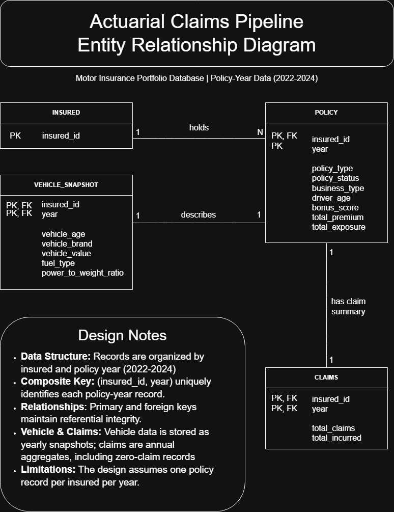

# Database Design

## Purpose

Defines the proposed PostgreSQL database schema for the Actuarial Claims Pipeline. The schema organizes the raw insurance dataset into normalized  tables that support efficient storage, querying, and actuarial analysis.

---

## Database Overview

The database is designed around five main entities: 

1. Insureds
2. Vehicles
3. Policies
4. Claims

---

## Entity Relationship Diagram

